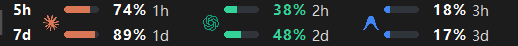
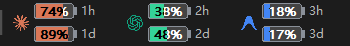
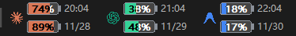
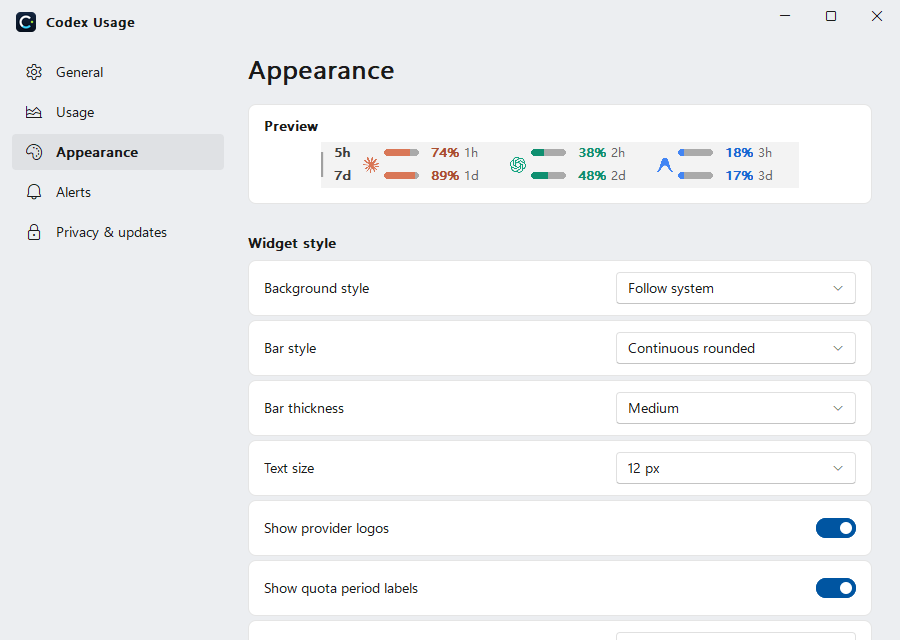
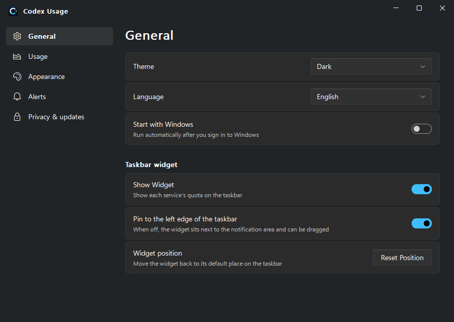

[](LICENSE)
[](https://github.com/upstream-ray/codex-usage-monitor/releases/latest)

**English** | [简体中文](README.zh-CN.md)

# Codex Usage — Windows Taskbar Quota Monitor


Codex Usage is a lightweight native Windows taskbar widget that monitors **OpenAI Codex**, **Claude Code**, and **Google Antigravity** usage limits and reset times. Enable one service or display all three side by side directly on the Windows 10 or Windows 11 taskbar without opening a browser or desktop app.

Built in Rust with native Win32 APIs (~1.2 MB single executable, no Electron or WebView2 runtime), it includes a Windows 11 Fluent settings window with light/dark themes, 12 interface languages, low-quota alerts, and an optional read-only local MCP server for AI agents.



**[Download latest release](https://github.com/upstream-ray/codex-usage-monitor/releases/latest)** · **[Installation & policy](docs/installation.md)** · **[Appearance guide](docs/appearance-customization.md)** · **[Local MCP setup](docs/mcp.md)** · **[Troubleshooting](docs/troubleshooting.md)**

---

## Requirements & Account Support

- **Operating system:** Windows 10 or Windows 11. Automatic refresh after network recovery requires Windows 10 version 2004 or later; earlier Windows 10 builds still refresh on schedule and after sleep wake.
- **Account prerequisite:** At least one supported CLI or app installed and signed in locally.

| Service | Default | Login Prerequisite | Local Credential Source | Quota Windows & Notes |
| --- | --- | --- | --- | --- |
| **Codex** | On | Codex CLI or Codex app signed in | `$CODEX_HOME/auth.json` or `~/.codex/auth.json` | 5-hour (`5h`) and weekly (`7d`) limits from the locally authenticated Codex account. |
| **Claude Code** | Off | Claude Code CLI signed in (Windows or WSL) | `~/.claude/.credentials.json`, `$CLAUDE_CONFIG_DIR`, or installed WSL distro | Supports Pro, Max, Teams, Enterprise, and Console accounts (not the free Claude.ai plan, per Anthropic docs as of March 19, 2026). **Signing in to Claude Desktop alone does not provide Claude Code credentials.** |
| **Google Antigravity** | Off | Google Antigravity signed in | Antigravity CLI `/usage` (falls back to Windows Credential Manager `gemini:antigravity`) | Shows 5-hour and weekly **Gemini Models** quotas by default; choose another reported group under **Settings → Usage → Antigravity quota group**. |

Unreported windows display `--` and an empty bar rather than a false `100%`. Missing or expired credentials show `!` on the taskbar and a sign-in warning inside **Settings → Usage**.

---

## Download, Install & First Launch

### 1. Per-User Install (Recommended)

Download `install.ps1` from the [latest release](https://github.com/upstream-ray/codex-usage-monitor/releases/latest), then run it in PowerShell (no administrator privileges required):

```powershell
powershell.exe -NoProfile -ExecutionPolicy Bypass -File .\install.ps1
```

The installer verifies the release SHA-256 checksum, installs to `%LOCALAPPDATA%\Programs\CodexUsage\codex-usage.exe`, creates Start Menu and Desktop shortcuts, registers an entry in Windows **Installed apps**, and launches the app automatically. It does **not** add the install folder to `PATH`.

### 2. Portable Run

Download `codex-usage.exe` from the same [release page](https://github.com/upstream-ray/codex-usage-monitor/releases/latest) and run it from any user-writable folder. Portable copies share the same `%APPDATA%\CodexUsage\settings.json` file and support in-app self-updates.

### 3. First Setup

1. Launch **Codex Usage** (automatically started after `install.ps1`, or via the Start Menu / Desktop shortcut).
2. Right-click the taskbar widget or the single system tray icon and choose **Settings…**.
3. Open **Settings → Usage** and enable **Codex**, **Claude Code**, and/or **Antigravity**. Every change takes effect and saves immediately.
4. Open **Settings → General** to switch the settings theme (**Follow system**, **Light**, **Dark**), UI language (12 languages), or **Start with Windows**.

### Upgrade & Uninstall

- **In-app updates:** Check and install updates from **Settings → Privacy & updates** (enabled by default; checks GitHub Releases and verifies SHA-256).
- **Uninstall:** Remove **Codex Usage** in Windows **Settings → Apps → Installed apps**, or run:

```powershell
powershell.exe -NoProfile -ExecutionPolicy Bypass -File "$env:LOCALAPPDATA\Programs\CodexUsage\uninstall.ps1"
```

Normal uninstall preserves `%APPDATA%\CodexUsage\settings.json`. Append `-RemoveSettings` to delete saved preferences as well. See the [Installation model](docs/installation.md) for upgrades, managed installations, and device policies.

---

## Reading the Taskbar Widget

Each enabled service gets its own column with independent status and retry handling.

- **Quota rows (`5h` / `7d`):** Represent the 5-hour session window and weekly window.
- **Extra Codex credits:** Turn on **Settings → Usage → Extra credits** to show the remaining balance in a two-line column beside Codex. This is off by default and appears only when Codex reports a valid balance. If taskbar space is insufficient, the credit column hides before the quota columns.
- **Remaining vs. Used:** Under **Settings → Usage → Quota value**, choose **Remaining** (default for new installs) or **Used**. Percentages, bars, and tray tooltips update together across all services and languages.
- **Reset time formats (consistent across all languages):**

| Mode (**Settings → Appearance → Reset time display**) | 5-hour (same day) | 5-hour (next day) | Weekly |
| --- | --- | --- | --- |
| **Countdown** *(default)* | `4h` / `45m` / `30s` | `4h` | `6d` |
| **Reset time** | `20:04` | `11/23 00:30` | `11/28` |

- **Exact local reset time:** Hover over any service column on the taskbar to see the full local date and time (`YYYY-MM-DD HH:MM`, for example `5-hour reset · 2026-11-22 20:04`), last successful update, next scheduled refresh, and any error details.
- **Common status indicators:**

| Display | Meaning |
| --- | --- |
| `--` and empty bar | The service does not report this window, or it reset at least 5 minutes ago and the fresh reading is still pending. |
| `*` after reading | The reading is stale (latest refresh failed or expired). If the window already reset, the old reset label is hidden until new data arrives. |
| `<1%` | Positive remaining or used quota below 1%. |
| `!`, `NET`, `429`, `5XX`, `ERR` | No data returned yet since startup: auth needed (`!`), network/TLS error (`NET`), rate limited (`429`), server error (`5XX`), or unexpected response (`ERR`). |

- **Taskbar & tray controls:**
  - **Drag** the left divider on the widget to reposition it on the taskbar, or drag it onto another monitor's taskbar.
  - **Double-click** the quota area to refresh immediately.
  - **Left-click** the tray icon to show or hide the taskbar widget; hover over it for a compact summary of all enabled services.
  - **Right-click** the widget or tray icon for the 4-item quick menu (**Refresh**, **Settings…**, **Show taskbar widget**, **Exit**).
  - Use **Settings → General → Pin to the left edge of the taskbar** and **Display** to control docking and multi-monitor persistence (temporarily falls back to the primary taskbar when a display disconnects, and restores automatically on reconnect).

---

## Customizing Appearance & Reducing Taskbar Width

Open **Settings → Appearance** to tune the widget with a live preview at the top:

- **Bar style:** Continuous rounded, Segmented, Dots, or **Battery** (with **Percentage position** set to **Outside battery** or **Inside battery**).
- **Bar thickness & text size:** Thin / Medium / Thick bars and `12 px` / `14 px` / `16 px` text (automatically steps down if the taskbar height is tight).
- **Background & colors:** Follow system, High contrast dark, or High contrast light backdrop; **Brand colors**, **By remaining quota** (green / amber / red), or **Single color** (5 curated swatches).
- **Quick looks:** One-click **Translucent dark** (high-contrast dark, thin continuous bars, `14 px` text) or **Restore defaults**.

### Making a 3-Service Widget Narrower

When monitoring Codex, Claude Code, and Antigravity at the same time, combine these settings to save taskbar space:

1. Under **Settings → Appearance**, set **Bar style** to **Battery** and **Percentage position** to **Inside battery**.
2. Turn off **Show quota period labels** (`5h` / `7d`) and/or **Show provider logos**.
3. Keep **Reset time display** on **Countdown** (narrower than cross-day clock timestamps).
4. Under **Settings → Usage**, optionally show only the 5-hour row or only the weekly row (at least one row always stays visible).







See the [Appearance customization guide](docs/appearance-customization.md) for all options and configuration fields.

---

## Refresh, Alerts & Startup

- **Independent polling & backoff:** Each service maintains its own schedule, error state, and exponential retry backoff. A slow or failing provider never blocks or overwrites another.
- **Update frequency:** Choose `1 min`, `5 min`, `15 min` (default), or `1 hour` under **Settings → Usage**. **Refresh faster when quota is low** (every minute when remaining is 20% or less) is on by default (exhausted `0%` windows stay on the normal schedule until reset).
- **Smart recovery:** Honors `429 Retry-After` headers, pauses auth retries when credentials are missing/expired until the credential file changes or you manually refresh, checks again shortly after a reset boundary, and refreshes automatically after sleep wake or network recovery.
- **Alerts (Settings → Alerts):**
  - **Low-quota alert:** Off by default; choose `10%`, `20%`, or `30%` remaining. Deduplicated once per service and reset window, even across app restarts.
  - **Notify on reset:** Off by default; notifies after a fresh reading confirms that a previously observed window has reset.
- **Start with Windows (Settings → General):** Launches automatically after signing in to Windows. If Windows has disabled the entry in **Startup apps**, Codex Usage detects the blocked state and displays an **Open Startup apps** button that jumps directly to Windows Startup settings so you can re-enable it.



For taskbar error codes and recovery steps, see [Troubleshooting](docs/troubleshooting.md).

---

## Privacy, Local MCP & Diagnostics

### Privacy & Network Behavior

Codex Usage is open source with no external backend and no telemetry.

- **What it reads locally:** Only the local credential/usage sources listed in the [Requirements & Account Support](#requirements--account-support) table for the services you enable.
- **Outbound network traffic:** Sends usage queries directly to the official endpoints of enabled providers (OpenAI ChatGPT Codex, Anthropic Claude, Google Cloud Code / Antigravity) and checks GitHub only when update checks are enabled. Outbound requests honor standard `HTTPS_PROXY` / `HTTP_PROXY` / `ALL_PROXY` environment variables.
- **Passive monitoring (on by default):** Under **Settings → Privacy & updates**, passive monitoring queries usage endpoints only and pauses retries on auth failures instead of invoking CLI refreshes or model inference. Inference-based fallback (such as Claude Messages API rate-limit headers) and background CLI token refresh run only if you explicitly switch passive monitoring off.
- **What it never does:** Never sends credentials to third-party servers, never uploads project files, never edits Codex `auth.json` directly, never writes Windows Credential Manager entries, and never reads Claude Desktop sessions.

### Local MCP Server for AI Agents

Under **Settings → Privacy & updates**, enable **Local MCP server** (off by default) to expose read-only quota tools over loopback (`http://127.0.0.1:46827/mcp`).

- Currently exposes `get_codex_usage` and `get_claude_usage` (Codex and Claude Code; Antigravity is not exposed via MCP).
- Reads directly from the widget's in-memory snapshot — tool calls make zero API requests and consume zero model quota.
- See the [Local MCP guide](docs/mcp.md) for Claude Code / Codex CLI setup, custom ports, JSON schema, and security boundaries.

### Diagnostics & Settings Path

Settings are stored in `%APPDATA%\CodexUsage\settings.json`. To write a diagnostic log to `%TEMP%\codex-usage.log` (version, install channel, failure categories, retry timing — never tokens or credentials):

```powershell
# Per-user installation
& "$env:LOCALAPPDATA\Programs\CodexUsage\codex-usage.exe" --diagnose

# Portable copy (from the folder containing codex-usage.exe)
.\codex-usage.exe --diagnose
```

---

## Frequently Asked Questions

### Can the Windows taskbar show Codex, Claude Code, and Google Antigravity quotas at the same time?

Yes. Open **Settings → Usage** and enable any combination of **Codex**, **Claude Code**, and **Antigravity**. Each service displays in its own column with independent polling, error handling, and color coding.

### If I am only signed in to Claude Desktop, can Codex Usage read my Claude Code quota?

No. Claude Desktop and Claude Code CLI use separate local sessions, and Codex Usage does not read Claude Desktop authentication data. Install and sign in to **Claude Code CLI** (on Windows or inside WSL), then enable **Claude Code** in **Settings → Usage**.

### How do I see the exact local reset time for 5-hour and weekly quotas?

Hover over a service column on the taskbar to see the full local date and time (`YYYY-MM-DD HH:MM`) for both the 5-hour and weekly windows. To show clock times directly on the taskbar instead of countdowns (`4h`, `6d`), set **Settings → Appearance → Reset time display** to **Reset time** (`20:04`, `11/23 00:30`, `11/28`).

### How can I make the taskbar widget narrower when all three services are enabled?

Set **Settings → Appearance → Bar style** to **Battery** and **Percentage position** to **Inside battery**, then turn off **Show quota period labels** (and optionally **Show provider logos**). Keeping **Reset time display** on **Countdown** or hiding one of the two quota rows under **Settings → Usage** reduces width even further.

### Why didn't Codex Usage launch after signing in even though Start with Windows was enabled?

Windows may have disabled the entry in **Settings → Apps → Startup**. Open **Codex Usage → Settings → General**: if Windows is blocking startup, the **Start with Windows** row displays a warning and an **Open Startup apps** button to jump straight to Windows Startup settings and re-enable it.

### Does monitoring quotas or enabling the local MCP server consume model quota or upload credentials?

No. By default, **Passive monitoring** is on, so Codex Usage only queries usage endpoints and never sends model prompts. Local MCP calls read the widget's cached in-memory snapshot on `127.0.0.1` without making network requests. Credentials stay on your machine and are sent only to the official provider endpoints over TLS (or your configured proxy).

---

## Building from Source & License

Requires Rust (2021 edition) on Windows:

```powershell
cargo build --release
```

The compiled single-file executable is written to `target\release\codex-usage.exe`.

- **License:** MIT License ([LICENSE](LICENSE)).
- **Icons:** Provider marks from [Lobe Icons](https://github.com/lobehub/lobe-icons) under the MIT License (see [src/icons/providers](src/icons/providers)). Brand names and marks belong to their respective owners.
- **Upstream acknowledgment:** Codex Usage is a maintained derivative of [CodeZeno/Claude-Code-Usage-Monitor](https://github.com/CodeZeno/Claude-Code-Usage-Monitor) by Craig Constable and contributors. Changes in this repository are not affiliated with or endorsed by the upstream maintainers, OpenAI, Anthropic, or Google.
