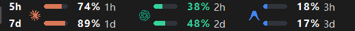
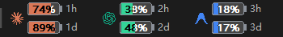
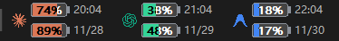
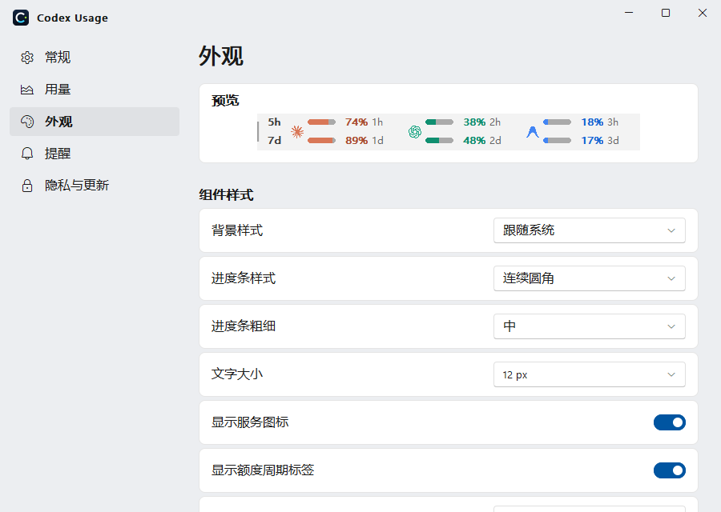
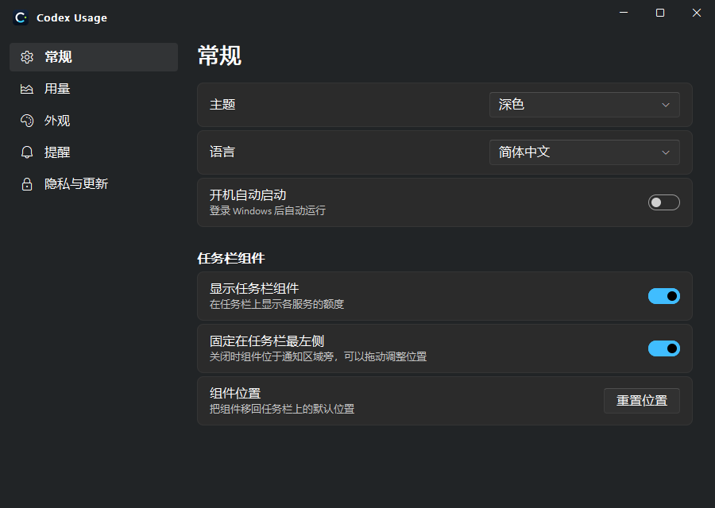

[](LICENSE)
[](https://github.com/upstream-ray/codex-usage-monitor/releases/latest)

[English](README.md) | **简体中文**

# Codex Usage — Windows 任务栏额度监控


Codex Usage 是一款轻量的 Windows 原生任务栏额度监控小组件，用于在任务栏直接查看 **OpenAI Codex**、**Claude Code** 和 **Google Antigravity** 的 5 小时与每周额度及重置时间。无需打开网页或桌面客户端，可单独监控其中一个服务，也可将三个服务并排显示在 Windows 10 或 Windows 11 任务栏上。

应用采用 Rust 与原生 Win32 API 编写（约 1.2 MB 单文件可执行程序，无 Electron 或 WebView2 运行时依赖），内置 Windows 11 Fluent 风格设置窗口（支持浅色、深色与跟随系统主题）、12 种界面语言、低额度与重置提醒，以及面向 AI 代理的本地只读 MCP 服务。



**[下载最新版本](https://github.com/upstream-ray/codex-usage-monitor/releases/latest)** · **[安装与托管策略](docs/installation.md)** · **[外观自定义指南](docs/appearance-customization.md)** · **[本地 MCP 配置](docs/mcp.md)** · **[故障排查](docs/troubleshooting.md)**

---

## 系统要求与账户支持

- **操作系统**：Windows 10 或 Windows 11。网络恢复后自动刷新需要 Windows 10 2004 及以上版本；更早版本的 Windows 10 仍会按设定周期及睡眠唤醒后正常刷新。
- **登录前提**：本机已安装并登录至少一个受支持的 CLI 或客户端。

| 服务 | 默认状态 | 登录前提 | 本地凭据来源 | 额度窗口与说明 |
| --- | --- | --- | --- | --- |
| **Codex** | 开启 | 已安装并登录 Codex CLI 或 Codex 应用 | `$CODEX_HOME/auth.json` 或 `~/.codex/auth.json` | 显示当前本地登录账户的 5 小时（`5h`）与每周（`7d`）额度。 |
| **Claude Code** | 关闭 | 已安装并登录 Claude Code CLI（支持 Windows 与 WSL） | `~/.claude/.credentials.json`、`$CLAUDE_CONFIG_DIR` 或已安装的 WSL 发行版 | 截至 2026 年 3 月 19 日 Anthropic 文档支持 Pro、Max、Teams、Enterprise 与 Console 账户，不支持免费 Claude.ai 方案。**仅登录 Claude 桌面端无法获取 Claude Code 额度。** |
| **Google Antigravity** | 关闭 | 已安装并登录 Google Antigravity | Antigravity CLI `/usage` 输出（查询失败时回退读取 Windows 凭据管理器 `gemini:antigravity`） | 默认读取 **Gemini Models** 的 5 小时与每周额度；可在「设置 → 用量 → Antigravity 额度组」切换其他已返回额度组。 |

服务未返回的额度窗口会显示 `--` 和空进度条，不再误显示为 `100%`。凭据缺失或过期时，任务栏显示 `!`，同时在「设置 → 用量」对应项下方给出登录提示。

---

## 下载、安装与首次使用

### 1. 按用户安装（推荐）

从[最新发布页](https://github.com/upstream-ray/codex-usage-monitor/releases/latest)下载 `install.ps1`，在 PowerShell 中运行（无需管理员权限）：

```powershell
powershell.exe -NoProfile -ExecutionPolicy Bypass -File .\install.ps1
```

安装脚本会校验发布文件的 SHA-256，将程序安装到 `%LOCALAPPDATA%\Programs\CodexUsage\codex-usage.exe`，创建开始菜单与桌面快捷方式，在 Windows「已安装的应用」中注册卸载项，并在安装完成后自动启动。安装过程**不会修改系统 `PATH`**。

### 2. 便携运行

也可以从同一[发布页](https://github.com/upstream-ray/codex-usage-monitor/releases/latest)直接下载 `codex-usage.exe`，放在任意当前用户可写的目录中运行。便携版与安装版共用 `%APPDATA%\CodexUsage\settings.json`，同样支持应用内自更新。

### 3. 首次配置

1. 启动 **Codex Usage**（运行 `install.ps1` 后会自动启动，后续可从开始菜单或桌面快捷方式打开）。
2. 右键单击任务栏组件或系统托盘图标，选择「设置…」。
3. 在「设置 → 用量」中开启需要监控的 **Codex**、**Claude Code** 或 **Antigravity**。每项改动会立即生效并保存。
4. 在「设置 → 常规」中按需调整设置窗口主题（跟随系统、浅色、深色）、界面语言（支持 12 种语言）及「开机自动启动」。

### 升级与卸载

- **应用内更新**：在「设置 → 隐私与更新」中检查并安装更新（默认开启，从 GitHub Releases 下载并校验 SHA-256）。
- **卸载**：在 Windows「设置 → 应用 → 已安装的应用」中卸载 **Codex Usage**，或运行：

```powershell
powershell.exe -NoProfile -ExecutionPolicy Bypass -File "$env:LOCALAPPDATA\Programs\CodexUsage\uninstall.ps1"
```

默认卸载会保留 `%APPDATA%\CodexUsage\settings.json`，以便重装后恢复配置；如需连同设置一起删除，请添加 `-RemoveSettings` 参数。升级迁移、托管安装与设备策略详见[安装机制](docs/installation.md)。

---

## 读懂任务栏组件

每个已启用的服务拥有独立的数据列、刷新节奏与错误状态。

- **额度周期（`5h` / `7d`）**：分别对应 5 小时额度窗口与每周额度窗口。
- **Codex 额外点数**：在「设置 → 用量 → 额外点数」中开启后，任务栏右侧会双行显示剩余点数。开关默认关闭；只有 Codex 返回有效余额时才显示。
- **剩余与已用**：在「设置 → 用量 → 额度数值」中可统一切换「剩余」（新安装默认）或「已用」。百分比数值、进度条填充比例与托盘摘要会同步切换，且不受界面语言影响。
- **重置时间格式（中英文任务栏使用统一简洁格式）**：

| 显示模式（「设置 → 外观 → 重置时间显示」） | 5 小时额度（当天重置） | 5 小时额度（跨日重置） | 每周额度 |
| --- | --- | --- | --- |
| **倒计时**（默认） | `4h` / `45m` / `30s` | `4h` | `6d` |
| **重置时刻** | `20:04` | `11/23 00:30` | `11/28` |

- **查看精确本地重置时间**：将鼠标悬停在任务栏上的任一服务列，即可查看 5 小时与每周额度的完整本地日期和时分（`YYYY-MM-DD HH:MM`，例如 `5 小时额度重置 · 2026-11-22 20:04`）、上次成功更新时间、下次刷新时间及具体错误原因。
- **常见状态说明**：

| 任务栏显示 | 含义 |
| --- | --- |
| `--` 与空进度条 | 该服务未返回此窗口额度，或窗口重置已满 5 分钟且新读数尚未返回。 |
| 读数后的 `*` | 当前显示的是过时读数（最近一次刷新失败或已超时）。若窗口已过重置时刻，旧重置时间会隐藏，等待新读数。 |
| `<1%` | 剩余量或已用量大于 0 但不足 1%。 |
| `!`、`网络`、`限流`、`服务`、`错误` | 启动后尚未成功获取过数据：需登录（`!`）、网络或 TLS 失败（`网络`）、触发限流（`限流`）、服务端异常（`服务`）或响应异常（`错误`）。 |

- **任务栏与托盘操作**：
  - **拖动**组件最左侧的竖向分隔线可自由移动位置，或直接拖到另一块显示器的任务栏。
  - **双击**组件右侧的额度区域可立即手动刷新。
  - **左键单击**系统托盘图标可快速显示或隐藏任务栏组件；悬停托盘图标可查看所有已启用服务的紧凑摘要。
  - **右键单击**组件或托盘图标打开精简菜单（刷新、设置…、显示任务栏组件、退出）。
  - 在「设置 → 常规」中可开启「固定在任务栏最左侧」或通过「显示器」指定目标任务栏；断开外接显示器时会暂落主任务栏，重新连接后自动恢复。

---

## 自定义外观与缩小组件宽度

在「设置 → 外观」中调整样式时，顶部预览区会实时显示效果：

- **进度条样式**：支持连续圆角、分段、圆点与**电池** 4 种样式；选择电池样式时，「百分比位置」可选「电池外」或「电池内」。
- **粗细与字号**：3 档进度条粗细（细 / 中 / 粗）与 3 档文字大小（`12 px` / `14 px` / `16 px`），当任务栏高度较窄时字号会自动降档防止裁切。
- **背景与配色**：背景样式可选跟随系统、高对比深色或高对比浅色；配色方式支持**品牌色**、**按余量变色**（绿 / 琥珀 / 红）或**统一单色**（5 种内置色块）。
- **快速外观**：支持一键套用「半透明深色」（高对比深色背景、细连续圆角进度条、`14 px` 字号）或「恢复默认」。

### 三个服务同显时如何缩窄组件宽度

同时开启 Codex、Claude Code 和 Antigravity 时，可按以下组合显著压缩任务栏占用宽度：

1. 在「设置 → 外观」将「进度条样式」设为「电池」，并将「百分比位置」设为「电池内」。
2. 关闭「显示额度周期标签」（隐藏 `5h` / `7d`），按需关闭「显示服务图标」。
3. 将「重置时间显示」保持为「倒计时」（比跨日「重置时刻」更紧凑）。
4. 在「设置 → 用量」中按需仅保留 5 小时额度或每周额度中的一行（应用至少保留一行）。







完整外观选项与配置字段详见[外观自定义指南](docs/appearance-customization.md)。

---

## 刷新、提醒与开机自动启动

- **多服务独立刷新与重试**：每个服务独立维护数据、错误状态和指数退避重试，单个服务超时或报错不会拖慢或覆盖其他服务。
- **更新频率**：在「设置 → 用量」中可选 `1 分钟`、`5 分钟`、`15 分钟`（默认）或 `1 小时`。「额度紧张时加快刷新」默认开启，当任一额度窗口剩余不超过 20% 时自动切为每分钟刷新（已用尽为 `0%` 的窗口维持正常间隔直到重置）。
- **自动恢复**：遵循服务端 `429 Retry-After` 提示；登录失效时暂停重试，直到凭据文件变化或手动刷新；窗口重置后会及时补查，并在电脑睡眠唤醒或网络恢复后自动刷新。
- **提醒（「设置 → 提醒」）**：
  - **低额度提醒**：默认关闭，可选剩余 `10%`、`20%` 或 `30%` 触发通知；每个服务的每个重置周期只提醒一次，重启应用也不会重复提醒。
  - **额度重置时通知**：默认关闭，在新读数确认已观察窗口完成重置后发出通知。
- **开机自动启动（「设置 → 常规」）**：开启后在登录 Windows 时自动运行。如果该启动项在 Windows 系统「启动应用」中被手动禁用，设置页会自动识别禁用状态，并显示「打开启动应用」按钮，点击即可直达 Windows 系统设置重新启用。



完整的状态码含义与排查方法见[故障排查](docs/troubleshooting.md)。

---

## 隐私、本地 MCP 与诊断

### 隐私与网络行为

Codex Usage 完全开源，没有自建后端服务，也不收集任何遥测或统计数据。

- **本地读取范围**：仅读取[系统要求与账户支持](#系统要求与账户支持)表中已启用服务对应的本地凭据或 CLI 输出。
- **网络请求范围**：仅向已启用服务的官方额度端点发送查询请求（OpenAI ChatGPT Codex、Anthropic Claude、Google Cloud Code / Antigravity），并仅在开启更新检查时访问 GitHub Releases。出站请求会遵循系统代理环境变量（`HTTPS_PROXY`、`HTTP_PROXY`、`ALL_PROXY`），请确保代理可信。
- **被动监控（默认开启）**：在「设置 → 隐私与更新」中控制。开启时仅调用只读用量接口，凭据失效时暂停重试，不触发模型推理或后台登录刷新；关闭后才允许后台调用本地 CLI 刷新令牌，或使用 Claude Messages API 响应头回退获取重置时间。
- **不会执行的操作**：不向第三方服务器发送凭据、不上传本地项目文件、不直接改写 Codex `auth.json`、不写入 Windows 凭据管理器、不读取 Claude 桌面端登录态。

### 供 AI 代理使用的本地 MCP 服务

在「设置 → 隐私与更新」中可开启「本地 MCP 服务」（默认关闭）。开启后仅在本机回环地址 `http://127.0.0.1:46827/mcp` 监听，向支持 MCP Streamable HTTP 的客户端提供只读额度查询。

- 当前提供 `get_codex_usage` 与 `get_claude_usage` 两个工具（覆盖 Codex 与 Claude Code，暂不包含 Antigravity）。
- 工具调用直接读取内存中的最近一次快照，不发外部请求、不读取凭据，也不会消耗模型额度。
- 客户端配置命令、自定义端口、返回字段与安全边界详见 [MCP 配置指南](docs/mcp.md)。

### 诊断日志与配置文件

所有设置保存在 `%APPDATA%\CodexUsage\settings.json`。如需排查启动、任务栏嵌入或轮询问题，可带 `--diagnose` 参数启动，日志会写入 `%TEMP%\codex-usage.log`（仅记录版本、渠道、错误分类与重试时间，不含令牌或凭据原文）：

```powershell
# 按用户安装
& "$env:LOCALAPPDATA\Programs\CodexUsage\codex-usage.exe" --diagnose

# 便携版（在 codex-usage.exe 所在目录运行）
.\codex-usage.exe --diagnose
```

---

## 常见问题

### Windows 任务栏可以同时显示 Codex、Claude Code 和 Antigravity 的额度吗？

可以。打开「设置 → 用量」，按需同时勾选 **Codex**、**Claude Code** 和 **Antigravity** 即可。三个服务相互独立，各自以独立列显示，互不影响刷新与报错。

### 只登录 Claude 桌面端，能读取 Claude Code 的额度吗？

不能。Claude 桌面端与 Claude Code CLI 使用相互独立的本地登录态，Codex Usage 不会读取 Claude 桌面端的认证数据。请在 Windows 或 WSL 环境中安装并登录 **Claude Code CLI**，再在「设置 → 用量」中开启 **Claude Code**。

### 怎么查看 5 小时和每周额度具体在什么时间重置？

将鼠标悬停在任务栏的对应服务列上，即可看到精确到分钟的本地重置日期与时间（`YYYY-MM-DD HH:MM`）。如果希望任务栏直接显示具体时刻而不是倒计时（`4h`、`6d`），可在「设置 → 外观 → 重置时间显示」中切换为「重置时刻」（显示如 `20:04`、`11/23 00:30`、`11/28`）。

### 三个服务都开启时，怎么让任务栏组件更窄？

在「设置 → 外观」中将「进度条样式」设为「电池」，把「百分比位置」设为「电池内」，并关闭「显示额度周期标签」（也可按需关闭「显示服务图标」）。保持「重置时间显示」为「倒计时」，或在「设置 → 用量」中只保留一行额度，可进一步缩小宽度。

### 为什么开启了开机自动启动，登录 Windows 后还是没有运行？

可能是该启动项在 Windows 系统「设置 → 应用 → 启动」中被禁用了。打开 Codex Usage 的「设置 → 常规」，若检测到被系统禁用，「开机自动启动」一栏会显示警告并提供「打开启动应用」按钮，点击即可直达系统页面重新启用。

### 监控额度或启用本地 MCP 服务，会额外消耗模型额度或上传凭据吗？

不会。「被动监控」默认开启，组件只请求官方额度接口，不会发起模型推理；本地 MCP 服务仅监听 `127.0.0.1` 并返回内存缓存，零额外网络请求、零额度消耗。所有凭据仅保留在本地，仅通过 TLS 向对应官方服务端点（或已配置代理）鉴权。

---

## 从源码构建与开源说明

在 Windows 上安装 Rust（2021 edition）后运行：

```powershell
cargo build --release
```

编译生成的单文件可执行程序位于 `target\release\codex-usage.exe`。

- **开源协议**：MIT License，完整版权声明见 [LICENSE](LICENSE)。
- **服务图标**：Claude 与 OpenAI 标志来自 [Lobe Icons](https://github.com/lobehub/lobe-icons)（MIT License），详见 [src/icons/providers](src/icons/providers)；各品牌名称与图标归其各自权利人所有。
- **上游致谢**：Codex Usage 是 [CodeZeno/Claude-Code-Usage-Monitor](https://github.com/CodeZeno/Claude-Code-Usage-Monitor) 的持续维护衍生版本，感谢 Craig Constable 及上游贡献者的原始工作。本仓库修改与上游维护者、OpenAI、Anthropic 及 Google 无隶属或背书关系。
