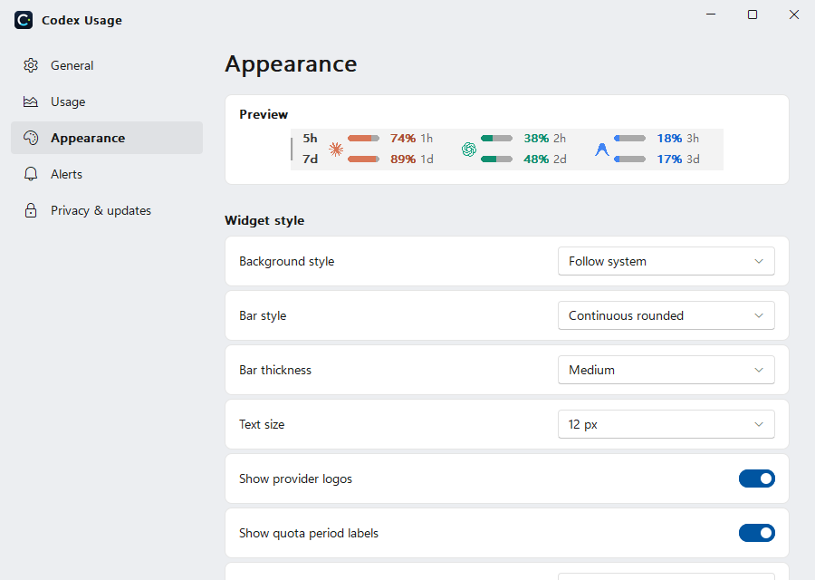
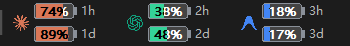
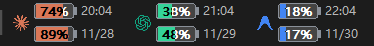

# Appearance customization

Open **Settings → Appearance** (Simplified Chinese: **设置 → 外观**) to customize the taskbar widget with a live preview at the top of the page. Every change applies and saves immediately.



## Widget style options

| Setting | Options | Default | Notes |
| --- | --- | --- | --- |
| **Background style** (`palette`) | `system`, `high_contrast_dark`, `high_contrast_light` | `system` | High-contrast modes add a solid backdrop and bold typography for readability on translucent taskbars. |
| **Bar style** (`bar_style`) | `continuous`, `segmented`, `dots`, `battery` | `continuous` | Continuous rounded bar, segmented bar, dot indicators, or battery icon bar. |
| **Bar thickness** (`bar_thickness`) | `thin`, `medium`, `thick` | `medium` | Logical bar heights of `4 px`, `7 px`, and `10 px` (capped to fit each row). |
| **Text size** (`font_size`) | `"12"`, `"14"`, `"16"` | `"12"` | Steps down automatically (`16` → `14` → `12`) when the selected taskbar height cannot fit both rows cleanly. |
| **Show provider logos** (`hide_provider_logos`) | On / Off | On | Controls whether the Claude, OpenAI, and Antigravity marks are shown before each service column. |
| **Show quota period labels** (`hide_period_labels`) | On / Off | On | Controls whether the `5h` / `7d` period labels are shown on the left edge of the widget. |
| **Percentage position** (`percent_inside_battery`) | Outside battery / Inside battery | Outside battery | Applies only when **Bar style** is set to **Battery**; placing percentages inside the battery significantly narrows multi-service layouts. |
| **Reset time display** (`reset_time_display`) | `countdown`, `clock` | `countdown` | **Countdown** shows compact durations (`4h`, `6d`, `45s`); **Reset time** shows local clock timestamps (`20:04`, cross-day `11/23 00:30`, weekly `11/28`). Hovering a column always shows the full `YYYY-MM-DD HH:MM` timestamp. |

## Color options

Colors apply uniformly across every enabled service:

- **Brand colors** (`color_mode: "brand"`, default): Uses each provider's signature accent (coral for Claude Code, green for Codex, blue for Antigravity).
- **By remaining quota** (`color_mode: "remaining"`): Colors bars by remaining headroom — green (`> 50%`), amber (`20%–50%`), and red (`< 20%`).
- **Single color** (`color_mode: "single"`): Applies one shared palette across all services, with five built-in swatches (`single_color`: `glacier`, `lilac`, `clay`, `rose`, `neutral`) adapted for light and dark backgrounds.

## Quick looks & presets

- **Translucent dark preset:** Applies `high_contrast_dark`, `continuous`, `thin`, and `14 px` text (optimized for dark translucent 40 px Windows taskbars).
- **Restore defaults:** Resets every appearance option back to `Appearance::default()`.

## Compact 3-service example

When displaying Codex, Claude Code, and Antigravity together, combine **Battery** style + **Inside battery** percentages + hidden period labels:





## Persistence & legacy migration

All options are stored under the `appearance` object in `%APPDATA%\CodexUsage\settings.json`. Older settings migrate automatically without losing unrelated preferences:

- `bar_style: "classic_segmented"` maps to `"segmented"`.
- `bar_thickness: "standard"` maps to `"medium"`, and `"slim"` maps to `"thin"`.
- `font_size: "standard"` maps to `"12"`, and `"large"` maps to `"14"`.
- Retired fields from earlier releases (such as per-Codex color overrides, `color_presets`, and single-service `compact_layout`) are safely ignored on load.

## Validation

Run:

```powershell
cargo fmt --check
cargo test --locked
cargo build --release --locked
```

To regenerate visual appearance fixtures and settings snapshots:

```powershell
$env:CODEX_APPEARANCE_PREVIEW_DIR = ".\tmp\appearance"
cargo test --locked render_appearance_previews -- --ignored

$env:CODEX_SETTINGS_SNAPSHOT_DIR = ".\tmp\settings"
cargo test --locked render_settings_snapshots -- --ignored
```
